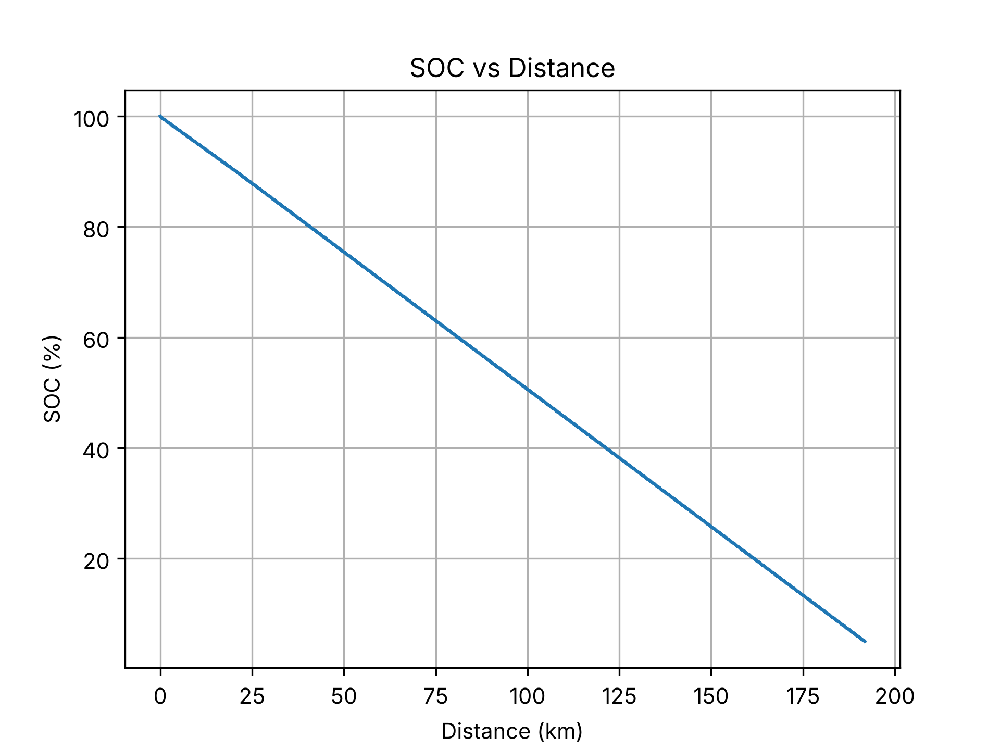
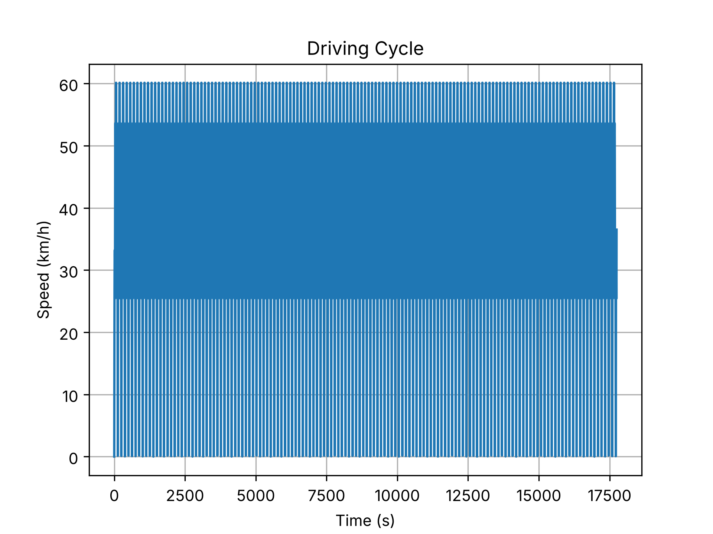
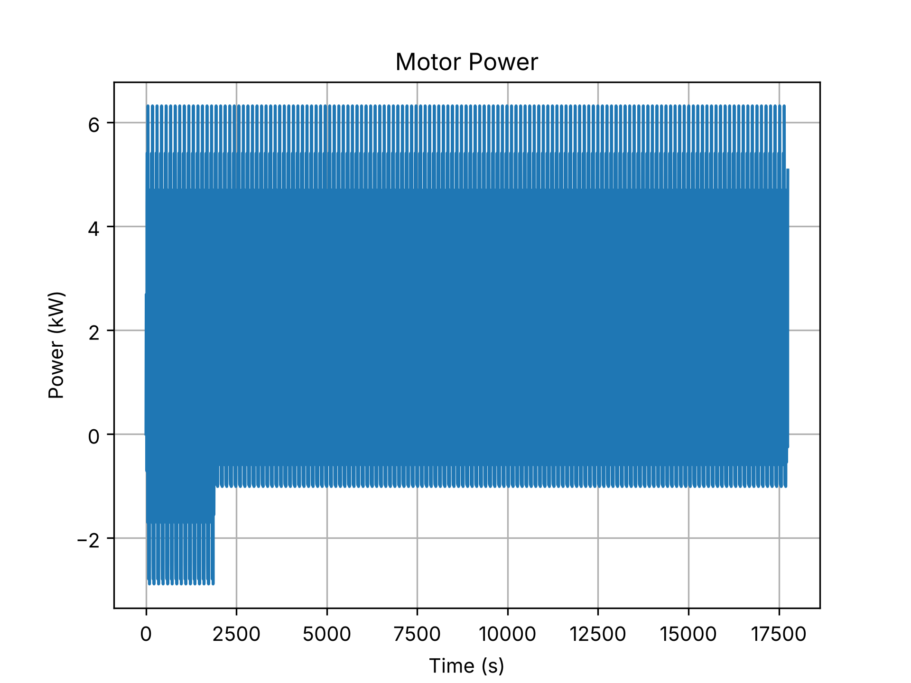
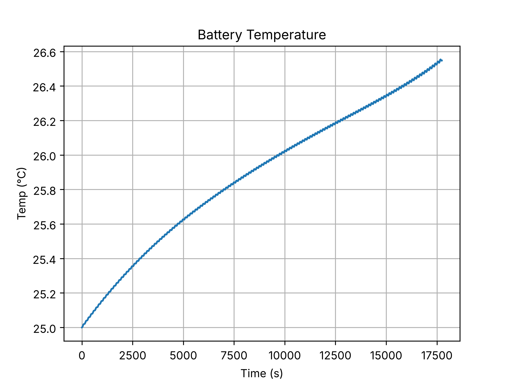

# EV Three-Wheeler Digital Twin

**Can a 16 kWh three-wheel passenger EV reach a 200 km range in city driving?**
I designed the vehicle and built a time-step Python digital twin of its powertrain, battery and thermal behaviour to check.

MSc Electric Vehicle Engineering, University of East London, module EG7023 Automotive Engineering (2026) · Usha Rani Vamanagiri · [LinkedIn](https://www.linkedin.com/in/usharaniv3)

## At a glance

| | |
|---|---|
| **Vehicle** | 3 wheels, 1 driver + 1 passenger, 350 kg kerb / 500 kg gross, 60 km/h top speed, 200 km range target |
| **Pack** | 16 kWh LFP, 100 cells in series |
| **Model** | Road load → motor torque and speed → motor and inverter losses → pack current, SOC and temperature, every 0.1 s until 5% SOC |
| **Result** | **192 km** to 5% SOC at **79 Wh/km**; pack temperature rises less than 2 K. The 200 km target is only met if the pack is run close to 0%. |



## What the model includes

| Subsystem | How it is modelled |
|---|---|
| Road load | Rolling resistance (C_rr 0.015), aerodynamic drag (C_d 0.45, A 1.2 m²) and inertia on a synthetic urban cycle up to 60 km/h |
| Driveline | 0.25 m wheel radius, 8:1 reduction, 90% drivetrain efficiency |
| Motor | Efficiency map that falls with torque² and speed², clipped between 75% and 93% |
| Inverter | Conduction loss (I²R_on) plus switching loss at 10 kHz |
| Regenerative braking | Fixed recovery efficiency, disabled above 90% SOC |
| Battery | OCV–SOC lookup, 0.12 Ω pack resistance, coulomb counting |
| Thermal | Lumped pack model: I²R heat generation against convective cooling |
| Auxiliaries | Constant 300 W load |

The full design (requirements, component selection, SolidWorks CAD, sizing calculations and sensitivity analysis) is in [`report/`](report/EG7023_Three_Wheel_EV_Design_Report.pdf).

## Results

| Driving cycle | Motor power |
|---|---|
|  |  |

| Pack temperature | |
|---|---|
|  | Per-step results (speed, tractive force, motor rpm and torque, power, SOC, distance) are in [`results/EV_results.xlsx`](results/EV_results.xlsx). |

## Run it

```bash
pip install -r requirements.txt
python src/ev_digital_twin.py
```

Prints the range, Wh/km and peak temperature, and writes the four plots to `figures/`. Runs in a few seconds. No local Python? Open [`notebooks/ev_digital_twin_colab.ipynb`](notebooks/ev_digital_twin_colab.ipynb) in Google Colab and choose **Run all**.

## Limitations and next version

These are known simplifications. Fixing them is the planned next iteration:

- **OCV curve:** the lookup runs from 3.0 V to 4.2 V per cell, which is a generic NMC-type curve. An LFP cell sits around 2.5 V to 3.65 V with a flat plateau, so the next version should use an LFP-specific curve.
- **Regenerative braking:** the recovery efficiency is applied at two points in the power chain, so recovered energy is underestimated. It should be applied once.
- **Drive cycle:** a synthetic sinusoidal cycle on flat road. The next step is to run WLTC Class 1 or a measured Indian urban cycle, with gradient.
- **Thermal and ageing:** a lumped pack model without hysteresis or capacity fade.

## Repository layout

| Folder | Contents |
|---|---|
| `src/` | The digital twin script |
| `figures/` | Plots generated by the script |
| `results/` | Per-step simulation output |
| `notebooks/` | Colab notebook that clones this repo and runs it |
| `report/` | Full EG7023 design report |
